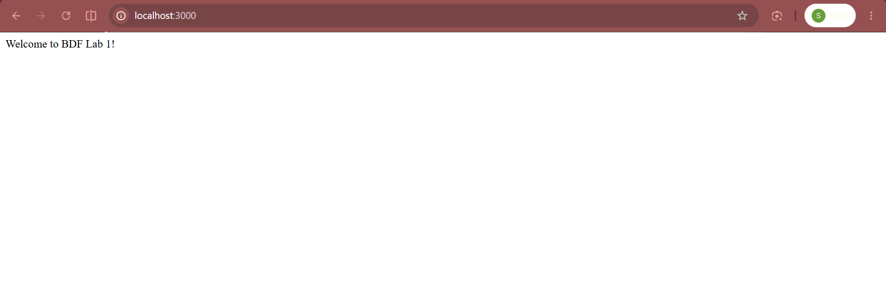
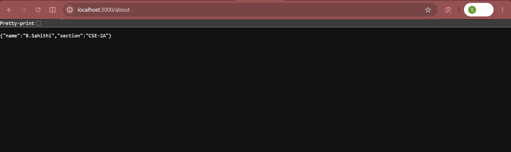
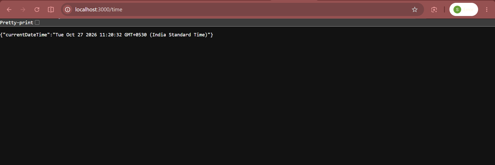
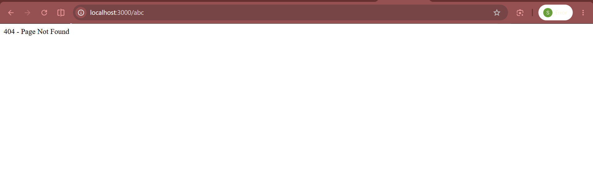
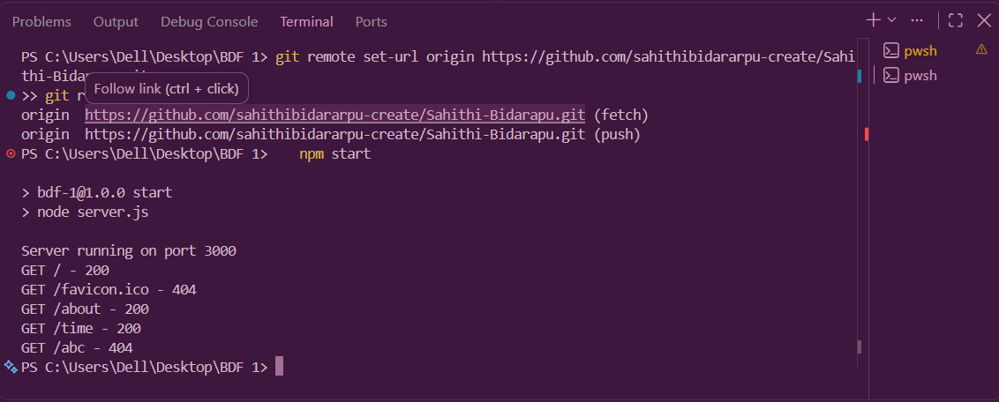

# Lab 1: Node.js and Express Server

   **Live URL:** https://sahithi-bidarapu.onrender.com

- **Name:** Sahithi Bidarapu
- **Registration No:** 252U1R1034
- **Section:** CSE Core 2A
- **Course:** Backend Development Fundamentals

## Installation

npm install

## Run

npm start

Open http://localhost:3000

## API Endpoints

| Method | Route | Response | Status |
| --- | --- | --- | --- |
| GET | / | Welcome text | 200 |
| GET | /about | JSON with name and section | 200 |
| GET | /time | Current date and time | 200 |
| GET | any other path | 404 - Page Not Found | 404 |

## Screenshots

## Notes

- server.js uses Express; plain-server.js uses the built-in http module.
- Each request's method, URL and status code is logged in the terminal.
- .env and node_modules are excluded using .gitignore.
